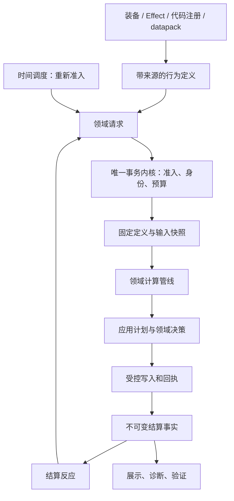

# CombatNexus 战斗行为与领域管线标准化计划

状态：设计计划及源码交付记录（2026-11-04）。本轮受控范围已接入源码，最终运行验收尚未完成，见第 16 节。设计中的候选能力不等于全部已交付。现有实现基线见 [开发约定](DEVELOPMENT.md)、[语义所有权与事务管线](SEMANTIC_OWNERSHIP_AND_TRANSACTIONS.md)和[冷热数据隔离架构](HOT_COLD_ARCHITECTURE.md)。本计划未完成前，现有开发合约仍然有效；改变既有行为必须单独记录和验收。

## 1. 目标与范围

将阶段管线从 damage 的局部组织方式，发展为各领域可复用的执行机制；将吸血等固定跨域调用发展为受控的结算反应；明确伤害前修正、应用前决策与真实世界写入的差别。最终让装备、Effect、被动和未来技能能够组合已有业务服务，同时保持明确所有权、输入一致性和失败证据。

本轮规划包括：

- 公共管线基础设施、领域专属阶段与强类型上下文。
- 条件、数值贡献、转换、应用决策、结算反应、观察器的权限分类。
- 确定性的贡献组合、来源归属、触发限制和因果关系。
- 前置行为、保护与替代、延迟调度及来源整体撤销的后续扩展路径。
- 领域事实、解释、诊断和 AutoJS 验收的一致模型。

仅面向 NeoForge 26.1.2 / Java 25。继续 source-set sharing；common 可以使用 Minecraft 类型，真实 API 差异留在 target。不新增另一套事务内核，不把业务集中到万能 pipeline/effect 模块。治疗仍为独立请求；formula 仍为无实体访问、无随机、无事件的确定性数值层。

不在此计划中承诺：完整技能系统、完整动作控制、Effect 持久化、通用脚本语言、跨服务器事务、数据库式回滚、持久 exactly-once、多平台兼容或所有扩展机制一次性交付。

## 2. 现有实现与变化性质

| 现有落点 | 已有能力 | 计划变化 |
| --- | --- | --- |
| `combat.internal.transaction.CombatServerRuntime` | 准入、预算、票据、完成 FIFO、世界绑定 | 继续作为唯一内核；扩展不能绕开 |
| `combat.api.CombatRuntime` | 世界服务组合、输入捕获、生命周期 | 接入领域管线与来源生命周期，不变成玩法注册总仓库 |
| `damage.core.pipeline.DamageModulePipeline` | 阶段处理器及排序 | 提取可复用机制，保留伤害阶段与原生 continuation |
| `healing.internal.DefaultHealingService` | 捕获、公式、应用、结算 | 作为第二个领域验证公共机制 |
| `combat.internal.coordination.CombatSettlementPolicies` | 恢复延迟、吸血固定调用 | 迁移为有 ID、条件和来源的结算反应 |
| `combat.api.transaction.CombatListeners` / `CombatCallback` | 确定性监听、短期子操作权限 | 复用发布边界和 FIFO，不另造事件总线 |
| `effect` 贡献计划、回执与协调 | 来源安装、部分失败、撤销 | 后续扩展到反应注册与定时任务的安装账本 |
| `combat.regeneration` | 恢复计时与治疗调度 | 保留恢复政策，按需复用公共调度设施 |

公共执行器提取、治疗阶段化、现有吸血接线迁移首先是行为保持重构。治疗溢出转盾、前置消耗、致死保护、伤害转移、周期伤害等是新增行为，不能使用“纯重构”名义混入。

## 3. 总体结构与所有权



公共机制建议落在 `combat` 的窄合约与内部实现中，具体包名在 S1 固定。候选边界为 `combat.api.pipeline`、`combat.api.reaction`、`combat.internal.pipeline`、`combat.internal.coordination`；这些是计划名称，不是现有 API。

| 层 | 负责 | 不负责 |
| --- | --- | --- |
| 事务内核 | 会话、身份、权限、预算、完成预留与发布 | 决定暴击、治疗量或 Effect 叠加 |
| 公共执行设施 | 注册冻结、稳定排序、调用边界、诊断标识 | 定义全领域共用阶段枚举、任意实体读写 |
| 领域管线 | 阶段、工作区、组合规则、计划和领域失败策略 | 绕过服务写其他域的状态 |
| 应用协调器 | 验证计划、控制写入顺序、采集回执 | 把候选计算结果冒充实际写入 |
| 跨域反应 | 从确认事实生成其他领域请求 | 直接扣血、改护盾内部余额 |
| 来源生命周期 | 安装账本、撤销、清理与协调 | 拥有所有玩法政策 |
| target | 原生采样、写入、事件/Mixin/网络接线 | 决定通用触发条件和公式 |

不要求所有领域使用同一实现继承树，不建立包含所有实体和服务的万能 Context。公开扩展只看到所需事实和受限操作；SPI 只向可信适配器开放必要接线。API 设计不承担恶意 Java 模组沙箱职责。

## 4. 三种阶段必须区分

### 4.1 事务生命周期

概念顺序为：身份与准入 → 业务资格 → 输入捕获 → 计算 → 应用前决策 → 写入 → 结算 → 反应。身份消耗、完成容量预留、权限验证和 finally 终结不能由扩展处理器删除或重排。

原生 damage 已经处于 hurt 调用栈时才获得完整关联，因此保留 Incoming/Pre/Post 与 continuation 的分段接线，不要求所有请求都先在栈外执行完整流程。

### 4.2 领域计算阶段

| 领域 | 候选组织方式 | 不变量 |
| --- | --- | --- |
| damage | 保留既有基础修改、类型、属性缩放、暴击、条件倍率、全局调整、减伤与最终覆盖顺序 | 不改变随机消费、真伤、通道和原版减伤所有权 |
| healing | 基础量 → 施加贡献 → 接收贡献 → 限制 → 计划 | 实际恢复与溢出只在原生应用后分类；现有接收倍率只消费一次 |
| shield 授予 | 基础量 → 修正 → 容量/来源策略 → 计划 | 授予、替换、叠加和过期有独立原因 |
| shield 吸收 | 选池 → 确定顺序 → 分配 → 参事务提交 | 复用 damage 本次准入；在既定原生应用位置提交 |
| effect | 资格 → 叠加决策 → 贡献计划 → 安装回执 → reconcile | 部分安装和补偿不能简化为普通数值阶段 |
| regeneration | 条件 → 合格时间累计 → 治疗请求 | 不再次实现治疗倍率或直接写生命 |

只在有真实扩展需求的步骤开放处理器。纯公式继续由 formula 提供，简单函数不为形式统一拆成空阶段。

### 4.3 结算反应与观察

结算反应消费不可变结果，可以在授权范围内提交子操作；观察器只读。二者都不能修改已确认的父操作结果。反应执行顺序确定，但前一个子操作的结算通知仍排到服务器 FIFO 尾部；依赖子治疗结果的逻辑必须挂在治疗结算上，不能依赖 damage 反应优先级猜测结果。

## 5. 行为角色与权限

| 角色 | 输入/输出 | 世界写入 |
| --- | --- | --- |
| 条件 | 捕获事实 → 判断及原因 | 禁止 |
| 修正器 | 领域输入 → 带来源的数值贡献 | 禁止 |
| 转换器 | 候选计划 → 领域认可的转换贡献 | 禁止 |
| 应用决策 | 计划与应用观察 → 选择/资源使用计划 | 不直接写，由协调器提交 |
| 结算反应 | 结算事实 → 子请求或明确服务操作 | 只经有效授权和服务 |
| 观察器 | 只读事实 → 有界诊断或展示 | 禁止 |

处理器不得自行进入 APPLICATION、签发票据、伪造回执、恢复过期 CombatParent 或直接排入完成队列。计算中的世界 gameplay 写入继续拒绝。所有有效计算数值必须有限并符合领域范围；拒绝值可作为诊断事实，但不可进入计算。

注册合约在 S1 明确：稳定命名空间 ID、允许阶段、确定性排序键、重复 ID 拒绝、冻结时点、注销句柄和错误策略。优先级只在明确阶段内比较。初期不引入任意 before/after 依赖图；未来若确有需要，须在采用前检测循环及缺失依赖。

## 6. 数值贡献与组合标准化

管线顺序和数值合成是不同合约。每种贡献必须声明来源、消费阶段、单位、运算类别、范围及解释规则。

| 组合方式 | 用途 | 必须说明 |
| --- | --- | --- |
| 加法 | 固定增量、额外暴伤 | 基数、负值许可、截断位置 |
| 同桶倍率 | 同类增伤 | 桶内相加公式及默认值 |
| 独立乘法 | 设计为独立的倍率 | 计算顺序、溢出与有限值处理 |
| 最值 | 同类保护择优 | 平局规则、未选来源是否消耗 |
| 排他选择 | 多个致死保护竞争 | 优先级、一次性消耗时点 |
| 转换分配 | 物理转元素、资源替代 | 总额约束、超额分配、转换链是否允许 |
| 限幅 | 治疗上限、容量 | 在哪些贡献前后执行 |
| 有序消耗 | 护盾池、消耗层数 | 稳定顺序、部分消耗回执 |

能收集贡献再统一求值的步骤优先这样实现；确实存在顺序语义的步骤使用有序决策。保留现有伤害桶的行为，禁止用“统一公式”顺带改变玩法。浮点归约采用固定顺序，不承诺不同归约顺序位级相同。

## 7. 结算反应模型

建议称为 Reaction，和管理持续状态的 Effect 区分。每项反应包含：ID、来源、触发节点、事实条件、目标选择、数值依据、生成动作、触发限制及诊断原因。初期代码注册；S10 再决定数据驱动范围。

| 反应 | 事实依据 | 动作及限制 |
| --- | --- | --- |
| 吸血 | 完整主伤害的确认生命损失 | 提交 healing；保留现有派生/反伤/护盾/吸收排除与比例范围 |
| 受击恢复延迟 | 确认生命或护盾损失 | 更新 regeneration；保留当前规则 |
| 反伤 | 明确定义的受击结果 | 提交派生 damage；声明是否响应反伤 |
| 溢出转盾 | 完成治疗中的确认溢出 | 提交 shield；满血与取消分别判断 |
| 破盾反应 | 指定来源池因吸收耗尽 | 不对过期、主动移除、替换默认触发 |
| 命中施加状态 | 所选命中/伤害事实 | 提交 Effect 安装；不能把 APPLIED 等同于生命损失 |

结算状态至少逐项分析：拒绝、取消、零量、全吸收、完整应用、PARTIAL、UNKNOWN、目标已死亡。默认不向部分/未知结果授予新的收益触发资格；已有确认写入仍保留。需要消费部分事实的特定反应必须显式声明证据条件与权限，不能一概把部分结果当失败或成功。

反应可用的来源集合在请求捕获时固定，避免执行到半途安装的新状态追溯影响本次操作；到派发时，来源是否仍有效另行校验。一次性来源的“本次消费后仍允许完成自身反应”须采用明确的消费记录，不通过重新查询当前装备猜测。该政策在 S1 定稿并覆盖卸装、死亡与来源移除。

## 8. 伤害前行为、应用前保护与替代

### 8.1 仅影响本次计算

低血增伤、格挡减伤、临时通道增量等通过贡献进入本次工作区，不安装持续 Effect，不重新读取未来实体状态。

“本次攻击施加易伤且本次享受易伤”优先拆成显式本次贡献与持续状态安装，并规定后者从何时生效，防止同一收益计算两次。

### 8.2 必须改变世界状态的前置操作

扣法力、消耗格挡层、先安装状态再捕获等需要独立编排。不得在 COMPUTE 内直接提交世界写入，也不得在一个输入帧中混合安装前后的属性。

若必须先写再计算，流程应明确为前置操作结算 → 重新捕获主操作输入 → 主操作；记录两个操作及因果关系。主操作失败不自动回滚前置成本。是否仅在主操作成功时扣成本属于另一种应用计划，不能混为同一种模式。该机制须扩展内核认可的授权路径，不能滥用生命周期 Permit。

### 8.3 保护与替代协调

致死保护、资源抵伤、护卫转移、伤害延期采用候选决策与应用计划，由领域协调器选定并提交。每种机制必须回答：

1. 多个候选竞争如何排序，未选候选是否消耗。
2. 成本预留、提交与释放的准确时点；预留不代表实际扣除。
3. 外部 Pre 取消或改量后，是否重新决策，最多重算几次。
4. 成本已扣但后续写入失败时，如何记录 PARTIAL/UNKNOWN。
5. 转移目标无效或子伤害被拒绝时，原目标是否仍减免。
6. 原生回调重入是否可能重复消费，如何用应用身份阻止。

初期一次只实现一种机制作为纵向样例。没有上述合约及运行证据，不开放万能“伤害前副作用”回调。

## 9. 动作、命中、因果和触发限制

攻击动作、命中判定、伤害应用、生命损失分别建模。当前只具备伤害事实的入口不得虚构命中成功或击杀归属。未来动作层可以生成多个 damage 请求，但不让 damage 内核兼任技能系统。

触发策略需明确计数范围：每操作、每目标、每动作、每根链、每来源、每时间窗口。多段攻击和范围攻击必须有真实动作标识，不能由同 tick 或同攻击者推断。

即时子操作复用根链预算与短期 CombatParent。记录直接原因、原始来源、触发行为 ID 和深度；因果标识只能用于解释，不能恢复授权。明确自触发、互触发、派生伤害触发、最大次数和冷却政策；根链预算仍作为最后的执行上限。

概率由受控随机入口处理，记录决策事实；formula 不抽随机数。规定不满足条件、被冷却阻止、预算不足时是否消耗随机数，以及尝试/成功分别何时消耗次数。S2/S3 迁移必须保持现有暴击随机调用次数及顺序。

击杀反应单独设计死亡确认与归属证据，不从预测伤害大于当前生命推断。复活、保护及外部生命写入都可能改变实际结果。

## 10. 时间调度与来源整体生命周期

### 10.1 时间调度

恢复、持续伤害、周期治疗、延迟爆炸可共享到期队列、取消句柄、稳定同 tick 顺序与有界任务容量。各领域拥有间隔、条件、跳 tick、合并及补发政策；不得改变现有恢复的合格 tick 与不补发规则。

延迟任务只保存有界来源/目标身份和所需值，不保存实体活引用、原请求定义仓库或 CombatParent。到期重新解析世界会话和目标并准入，分离历史因果标识与执行权限。预算耗尽时明确跳过、延期或拒绝，不无界重试。

定义变化策略必须显式选择：使用到期时定义，或安装时复制的有界值计划；默认不长期持有旧 generation 完整仓库。卸载、换维度、死亡和来源移除如何取消由领域声明。原版已计时的食物/再生 Effect 不同时接管。

### 10.2 来源安装账本

一个装备或 Effect 来源可以拥有属性贡献、计算贡献、结算反应及周期任务。统一来源身份和可撤销句柄；各项状态仍存放在所属服务。区分“不可变行为定义注册”和“某实体来源实例激活”，不能把运行时卸装实现为修改全局处理器注册表。

沿用 prepare → apply → Receipt → reconcile：部分安装进入账本，撤销可重入，完整回执后才视为 active。安装未完成的行为不参与新操作；已捕获操作与来源撤销的关系按第 7 节处理。待协调只阻塞相关来源，不冻结所有无关来源。

死亡、重生、换维度、退出及卸载需要同时清理属性、行为激活和任务。客户端只展示最终认可状态，不自行计时产生权威收益。

## 11. 定义、事实、诊断与性能

代码处理器注册在固定生命周期冻结；datapack 行为定义与设置、通道、规则、模板一起整批校验并采用 generation。动态来源激活属于世界会话，不与定义注册混用。失败重载保留旧代际，在途操作保留已捕获定义，历史只存代际标识。

公共结果元信息可以包含操作/来源身份、会话、generation、完成状态和 journal；领域事实保持强类型，不把全部结果压入任意键值 Map。

| 领域 | 必需专属事实示例 |
| --- | --- |
| damage | 通道量、护盾损失、吸收损失、生命损失、应用完成证据 |
| healing | 接受量、实际恢复、溢出、取消及写入证据 |
| shield | 来源池、授予/替换/吸收/过期/移除原因 |
| effect | 安装/刷新/叠加/移除及贡献协调状态 |
| reaction | 反应 ID、来源、匹配结果、拒绝原因、子请求身份 |

诊断记录受限，记录被截断不能改变随机、触发次数和资源结果。热路径不拼接 tooltip、不解析 JSON、不复制整份历史。保持现有历史和面板预算，新增字段也计入编码及构造预算。

性能以迁移前后相同负载比较，包括每操作时间、分配量、任务/来源容量、FIFO 峰值和长期定义保留。先测量再决定缓存或稠密数组；不可为提速按 tick 复用权威输入。性能阈值在 S1 基线测量后确定，不预先宣称零开销。

## 12. 失败合约

| 失败位置 | 要求 |
| --- | --- |
| 注册/定义采用 | 重复 ID、阶段不合法、非有限值等在采用前拒绝；保留旧代际 |
| 计算回调 | 按领域严格/宽松策略处理，checkpoint 同步恢复数值及贡献事实；不宣称回滚外部副作用 |
| 应用前决策 | 尚未写入可取消计划；已写成本须进入 journal |
| 资源应用 | 保留确认写入，PARTIAL/UNKNOWN 不自动重试或推断零写入 |
| 结算反应 | 隔离失败，不撤销父操作，不重复投递；已完成子写入仍保留 |
| 来源撤销 | 按账本协调未撤项目，不重复移除已完成项 |
| 到期任务 | 会话/目标/预算无效时执行明确终态政策，不保留过期授权 |

各模块可有不同业务失败结果，但共用基础错误分类与诊断标识。不能用统一 catch-and-continue 掩盖关键阶段失败，不能降低 Mixin require。

## 13. 分阶段实施与交付门槛

所有阶段初始均为待实施；本轮源码状态见第 16 节。每阶段独立记录改动、破坏性 API 变化、脚本及实测结果；没有运行证据不能标记完成。

| 阶段 | 工作与产物 | 依赖 / 完成门槛 |
| --- | --- | --- |
| S1 合约与基线 | 列出现有阶段/监听/写入入口；固定排序、失败、来源有效性和随机合约；记录现有场景数值与运行成本 | 无；设计与基线记录可审查，计划脚本不得冒充已运行 |
| S2 公共设施及 damage 迁移 | 提取注册/排序/执行工具；保留领域上下文、阶段及 native continuation；清理被替换执行路径 | S1；数值、随机次数、通知次数及原生证据回归一致 |
| S3 healing 领域管线 | 第二种上下文验证抽象；维持接收倍率、原生事件与单次写入；不默认启用新增施加倍率 | S2；正常/满血/死亡/取消/异常/溢出结果一致 |
| S4 标准结算反应 | 迁移吸血和恢复延迟；增加反应 ID、触发条件及诊断；删除重复固定调用 | S2–S3；同一收益只有一个 owner，父权限与 FIFO 不变 |
| S5 来源账本扩展 | 将行为激活及撤销接入 Effect/装备来源；验证部分安装和来源失效 | S4；卸装/死亡/换维度后无残留贡献，已捕获操作语义明确 |
| S6 应用前决策 | 选择一种保护或成本机制贯通计划、回执、失败处理；再决定是否推广 | S5；取消、竞争、重入、部分写入覆盖；玩法变化单列 |
| S7 调度设施 | 提取共用到期/取消机制，先迁移现有恢复，再加入一个受控周期行为 | S5；时间边界、预算、任务容量与清理验证；无旧定义长驻 |
| S8 动作与触发政策 | 引入真实动作/命中身份；实现多段/范围计数及明确来源链；按需要补击杀事实 | S4；原生事件可提供可靠证据，否则对应能力保持未开放 |
| S9 展示与可观测性 | 暴露有界反应/来源解释，完善 trace、拒绝原因及性能对照 | 随前述阶段推进，最终在 S6–S8 后收敛；网络和客户端实测 |
| S10 数据驱动收敛 | 只开放已稳定条件/贡献/反应的数据定义；整批采用及容量限制；更新 API/配置文档 | S4–S9 的相关能力已验收；不提供任意代码执行 |

优先完成 S1–S4 形成最小闭环。S5–S10 是后续扩展，不因最小闭环完成而宣布整份计划完成。若两个领域仍无法共享某个抽象，先保留领域实现并记录差异，不为形式统一增加运行时类型判断。

## 14. AutoJS 验收计划

不恢复 JUnit/GameTest。以下六个脚本已创建，最终版本尚未运行；执行时复用 `scripts/run-autojs.py` 和现有运行设施，避免平行启动框架。

| 拟新增脚本 | 主要覆盖 |
| --- | --- |
| `scripts/autojs/verify-domain-pipelines.js` | 阶段/排序、重复注册、受限上下文、失败 checkpoint、伤害与治疗结果 |
| `scripts/autojs/verify-combat-reactions.js` | 吸血、恢复延迟、FIFO、回调失败、过期父权限、派生循环与预算 |
| `scripts/autojs/verify-behavior-sources.js` | 来源安装/撤销、部分回执、装备替换、重复清理、卸载 |
| `scripts/autojs/verify-preapplication-decisions.js` | 候选竞争、取消、成本消耗、重入、PARTIAL/UNKNOWN |
| `scripts/autojs/verify-combat-scheduling.js` | 到期顺序、跳 tick、取消、容量、重载、失效会话 |
| `scripts/autojs/verify-action-trigger-policy.js` | 多段/多目标、每动作次数、冷却、随机次数、击杀证据边界 |

最低场景矩阵：

- 正常：无扩展行为的基线；多来源叠加；主伤害吸血；子治疗通知；护盾部分/全吸收。
- 边界：零量、满血、概率 0/1、容量刚满、同优先级、同 tick 两次请求、来源在回调中撤销、同一参与者重复出现。
- 失败：取消、重复提交、非法数值、预算不足、完成队列不足、计算异常、原生写后异常、观察证据缺失。
- 生命周期：死亡、重生、换维度、退出、世界卸载、停服；旧句柄和旧响应拒绝。
- 定义：重载成功/失败、在途旧 generation、新请求新 generation、延迟任务定义政策与保留上限。
- 循环：反伤对反伤、治疗转伤害再吸血、自触发；额度拒绝后资源与通知次数正确。
- 展示：服务端权威事实与来源一致、超预算明确拒绝、断线清缓存、冷记录淘汰不影响热计算。

每次运行记录代码提交/工作树标识、脚本路径、JDK/NeoForge/模组版本、数据清单、操作输入、预期、实际断言数、日志位置和未覆盖项。不得将现有 127 项断言当作新增机制已被验证。性能测量同时记录预热、样本量、负载和 JFR 局限，不以一次小样本宣称生产性能。

涉及源码的交付按仓库要求执行：活动 target 目录 `gradlew clean build`、根 wrapper `-p common clean build`、`python scripts/verify-common-boundary.py`、`python scripts/verify-baseline.py`；Mixin、事件、网络和资源变化另做对应运行验证。构建通过只证明构建范围，不代表上述行为已验收。

## 15. 完成定义与维护规则

每个已完成阶段必须给出：最终接口与所有权、删除的旧路径、是否改变数值/随机/触发、实际脚本与结果、构建范围、剩余限制。公开 Java API 如发生破坏性变化直接记录，不增加旧包门面、协议握手或隐式兼容分支。

本计划的近期完成条件是 S1–S4 全部验收：damage/healing 共享可复用机制，吸血与恢复延迟使用同一结算反应合约，事务权限和既有行为不退化。扩展阶段分别标记，持续维护支持矩阵；未实施条目不能写入 README 的当前功能声明。

### 本次文档交付记录

- 2026-11-04：新增计划并链接到开发文档入口；仅文档变更。
- 计划建立时：S1–S10 均未实施；本轮源码交付及验证边界见下节。


## 16. 本轮源码交付与验收边界（2026-11-04）

用户选择实施 S1–S10 的受控闭环，并确定一次性致死保护、周期治疗、反伤和溢出转盾。运行期间用户随后明确要求“暂不接受，仅执行源码与构建检查”。收到回复后已停止隔离开发服务器，未再次启动或执行 AutoJS，没有手动设置 `eula=true`。**本节记录源码交付，不表示各阶段已通过最终运行验收。**

### 16.1 实现状态

| 阶段 | 本轮源码 | 尚待验收 |
| --- | --- | --- |
| S1 | 注册、阶段、原生写入及 FIFO 入口检查；迁移前 83 项既有断言基线 | 新增性能基线和阈值未测定 |
| S2 | `DomainPipeline<P,H>` 共用注册冻结、排序、执行；damage 保留 checkpoint、阶段与 continuation；删除旧版本轮询与排序路径 | 最终原生数值、随机和通知回归 |
| S3 | `HealingPipeline` 基础量→来源贡献→received→限制；应用与分类仍由 healing 服务拥有 | 最终正常/边界/失败矩阵 |
| S4 | `SettlementReaction` / `ReactionSet`；迁移恢复延迟、吸血，删除 `CombatSettlementPolicies`；加入反伤和溢出转盾 | 最终权限、FIFO、失败与循环 |
| S5 | Effect 回执组合行为安装、捕获、撤销、补偿及装备来源；来源失效阻止反应 | 最终装备事件、部分失败与生命周期 |
| S6 | 最终原生生命写入前一次决策；保护消费进入 `PROTECTION` journal | 最终 Pre 取消、重入及写后异常 |
| S7 | `DueQueue` 共用到期/取消机制；迁移恢复，加入受管周期治疗 | 最终 tick 边界、容量、预算及清理 |
| S8 | `Player.attack` 作用域产生真实动作 UUID；同次横扫共享身份；显式触发计数 | 实际玩家攻击、横扫多目标及 FakePlayer 脚本 |
| S9 | 来源状态与有界反应事实接入本人面板，沿用行数/编码预算 | 客户端、网络及性能对照 |
| S10 | 有界行为 JSON 与既有定义同 generation 整批采用；四个惰性样例与显式安装 API | 实际成功/失败重载及资源运行 |

初期新增数值贡献仅开放治疗固定增量：按固定来源顺序汇总，统一截断到零，再消费 received。2026-11-05 已修复此前逐来源截断的问题，详见第 17 节。伤害原有桶及暴击随机调用位置不变；新增反应不抽随机数。不宣称已实现通用转换 DSL、完整技能系统、击杀事实或所有领域的扩展回调。

### 16.2 固定合约与 API 变化

- `registerPhaseProcessor(Identifier, DamagePhaseProcessor)` 返回 `PipelineRegistration`。ID 唯一且不超过 256 字符；阶段/优先级在注册时固定，初始化结束冻结，注销仅限冻结前。阶段内优先级降序，内置先于外部；内置按 ID，外部保留注册顺序。非法注册显式拒绝，不提供旧签名门面。
- `CombatInputFrame` 带至多 64 个同实体、同会话来源；damage 计划/证据带来源及可选真实动作身份；healing 结果带同次来源。`DefinitionGeneration` / `CombatDefinitions.Snapshot` 带行为目录，构造快照的脚本须显式保留目录。`ShieldPoolService.replace` 返回 `ShieldGrantReceipt`；子请求身份只用于解释，不恢复权限。
- 来源派发时再次校验，失效则跳过。保护消费一次性资格但不自动移除整个 Effect；消费记录及其他有效行为保留。撤销再安装使用新身份，旧快照不能复活。部分安装不激活；补偿保留已消费保护和触发额度，未完成补偿阻塞相关来源。
- 保护默认每来源一次，按优先级、来源 ID、安装顺序选择。仅最终拟写值致死且有损失时消费，留下 `min(写前生命, 1)`；未选来源不消费。成本在生命写入前提交，后续异常不返还；每应用最多决策一次，不重跑 Pre。
- 周期治疗默认每 20 tick 恢复 1 点基础生命，持续 200 tick；首次第 20 tick，期限 tick 不执行。刷新重新计时；跳 tick 最多一次、不补发。异常消耗本次机会，不阻断其他来源；不接管原版再生。恢复仍聚合 20 个合格 tick，保持 100 tick 战斗窗口与独立 damageDelay。任务和恢复计划各限 4096。
- 反伤默认完整主伤害确认生命损失 × 20%，目标为直接攻击者；不响应派生/反伤，不触发吸血。溢出转盾默认 100%，满血完整治疗允许，取消/零溢出/PARTIAL/UNKNOWN 不允许；同安装来源池容量 20、持续 100 tick，成功增量授予刷新期限。来源撤销清理其派生池。
- 满血治疗仅给内部转盾回调 SHIELD 权限，普通治疗监听器权限不扩大。反应失败不撤销父操作、不重投；记录结果及子请求身份。事实最多 256 条，本人面板最多展示最近 16 条，计入既有预算。
- 触发额度在条件满足后的动作尝试时消费；预算拒绝或子请求失败不返还。ACTION 无真实身份拒绝；TARGET 表示每根链每目标；SOURCE 表示安装实例寿命。同步 operation/action/root 计数下一 tick 清理，延迟任务重新准入；容量 4096，满额拒绝。
- 装备使用 `combatnexus:equipment_bindings` 类型化多绑定组件，按槽位和稳定绑定 ID 安装。旧 custom_data 字符串拒绝，完整生命周期和迁移见 [领域定义](DOMAIN_DEFINITIONS.md)。

### 16.3 受限数据与安装

路径 `data/<namespace>/combatnexus_behaviors/<id>.json`，最多 256 项，每文件最多 16384 字符。仅接受完整键集合，非法字段或范围使整批重载失败并保留旧代际：

```json
{
  "priority": 0,
  "duration_ticks": 200,
  "components": [{"type": "periodic_healing", "amount": 1, "interval_ticks": 20}]
}
```

当前格式为类型化组件，每个反应独立限额；完整 schema 和其他领域目录见 [领域定义](DOMAIN_DEFINITIONS.md)。比例 0..1；容量/周期量 0..1000000；治疗增量 -1000000..1000000；优先级 -10000..10000；时间字段 1..1200000 tick；次数 1..64。触发范围为 `OPERATION`、`TARGET`、`ACTION`、`ROOT`、`SOURCE`，仅控制结算反应，不改变保护消费或周期计时。

内置 ID：`combatnexus:last_stand`、`combatnexus:periodic_healing`、`combatnexus:reflection`、`combatnexus:overflow_shield`。代码通过 `BehaviorEffects.install(world, target, definition, source)` 安装，或构造带 `BehaviorPlan` 的 managed `EffectInstance`。定义本身不激活；已安装来源持有复制值，新安装使用新代际，不长期持有旧仓库。

### 16.4 实际证据与限制

- 基线提交 `0771c158570d6a41671d81d0b1dca4a1e9229042`，启动时仅有用户原有文档修改。环境：Windows、JDK 25.0.3、NeoForge 26.1.2.126、CombatNexus 0.1.0-SNAPSHOT、AutoJS 1.0.1、Rhino 2101.2.8-build.91；迁移前 target `build` 通过。
- 在用户限制运行前，基线及首轮中间源码的 `verify-architecture-runtime.py --port 25589` 分别通过 83 项。首版新增脚本通过保护 8 项、反应 8 项、来源 6 项，涉及基础竞争/消费、反伤、满血转盾、容量、FIFO 和撤销。中间源码未提交且随后继续修改，**不能作为最终源码或当前扩展后脚本通过的证据**。
- 六个最终脚本已创建，`verify-behavior-runtime.py` 复用 `run-autojs.py`；`--definitions` 可检查真实整批重载。最终脚本仅做语法检查，未再执行。快照/代际脚本已更新构造参数。
- 最终源码的活动 target `gradlew clean build`、根 wrapper `-p common clean build` 均通过；`verify-common-boundary.py` 通过（783 个类），`verify-baseline.py` 通过（613 个活动源码类、metadata、Mixin、资源、许可证）。六个新 JS 脚本通过 `node --check`，Python runner 通过语法检查，`git diff --check` 通过。空 test 任务不计行为覆盖。
- 构建不证明新增 Mixin、事件、网络或资源运行正确；客户端、原生取消/重入/异常、横扫、装备事件、断线、重载与预算压力仍待验证。
- 无新增 JFR 样本、性能阈值或性能通过声明。原始基线报告与已有服务器日志保存于活动 target 的 `build/verification`，不入库且可能被后续 clean 删除。

## 17. ownership 审查修复（2026-11-05）

第 16 节构建计数及中间运行结果为 11-04 的历史记录。当前六项问题、接口所有权、数值修复、AutoJS 脚本增量及实际构建检查见 [BEHAVIOR_OWNERSHIP_REVIEW.md](BEHAVIOR_OWNERSHIP_REVIEW.md)。来源/反应业务接口现在只读，应用决策与动作接线使用可信 SPI；治疗计划和结算新增有界不可变贡献事实。六项源码修复不等于最终运行验收完成。
