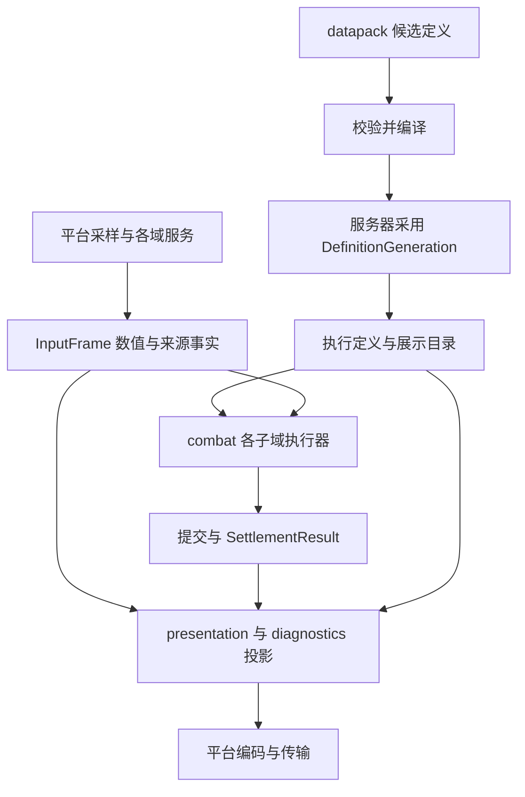

# CombatNexus 冷热数据隔离架构

本方案面向 NeoForge 26.1.2、Java 25，以业务域内的数据拆分减少每次结算承担的展示与诊断工作。保留 `combat`、`attribute`、`formula`、`effect`、`presentation` 的职责划分，不新增包揽所有业务的 hot/cold 模块。计算和展示仍消费同一次服务端捕获的权威事实，来源明细不能通过事后重读实体补齐。

状态：已实施（2026-11-04）。A1–A6 已在 common 与活动 NeoForge target 中接通；本文保留设计约束，并记录当前落点、实际验证与测量限制。事务边界见 [语义所有权与事务管线](SEMANTIC_OWNERSHIP_AND_TRANSACTIONS.md)，开发约束见 [DEVELOPMENT](DEVELOPMENT.md)。

## 数据分类与所有权

“热”表示每次攻击、治疗、护盾提交或 tick 推进必需访问；“冷”表示重载、查询、解释、诊断时使用。不可变不等于冷，配置中的公式参数虽低频更新，却被热路径读取。冷数据也不等于可丢弃：来源身份和计算事实是解释正确性的一部分。

| 数据类别 | 典型内容 | 所有者与生命周期 | 访问约束 |
| --- | --- | --- | --- |
| 定义原文与展示元数据 | JSON、规则名称、翻译键、tooltip 模板、单位说明 | 各域定义仓库；一次成功资源 generation | 解析、校验、编译在重载阶段完成；热路径只持有不可变代际句柄 |
| 编译后的执行定义 | 通道索引、规则顺序、操作参数、公式参数、限额 | 服务器定义快照；generation 内共享 | 热读、不可变；禁止每次命中解析 JSON 或拼接展示文字 |
| 世界实体状态 | Effect 生命周期、护盾余额、恢复计划、属性修订 | 世界 CombatRuntime；实体会话内可变 | 服务端线程独占；通过各域服务修改，卸载时释放 |
| 请求输入 | 属性有效值、生命/装备/Effect 条件、攻击来源、请求设置 | 单次请求的 InputFrame | 扩展回调前捕获；本次执行不可变，同 tick 后续请求重新采样 |
| 请求工作状态 | 数值桶、阶段、暴击结果、取消、预算、写入证据 | 子域执行器及服务器事务内核 | 热且可变；不得包含 tooltip、JSON 树或历史日志列表 |
| 权威来源事实 | modifier 来源、操作序号、实际参数、接受/拒绝原因、贡献顺序 | 与 InputFrame 或结果共同标识的 provenance | 捕获后不可变；按来源块共享，不反算数值、不读取未来状态 |
| 展示与诊断投影 | 面板行、翻译参数、格式化日志、历史解释 | presentation 或 diagnostics；按需且有界 | 从指定修订投影；不得反向修改战斗结果或持有活实体 |

不先引入对象池、全局数组或堆外存储。先消除不必要的格式化和重复对象图，再通过测量决定是否将通道/属性映射改为稠密数组。若采用数组，索引仅在对应 generation 内有效，公开接口继续使用稳定 ID。

## 模块与数据流

当前合约及落点如下；沿用各域实现，没有另建平行运行系统。

| 合约 | 当前落点 | 责任 |
| --- | --- | --- |
| DefinitionGeneration | `combat` 组合层，具体定义仍归各子域 | 原子绑定设置、通道、规则、模板及展示目录；显式服务器所有者 |
| AttributeValueFrame / AttributeProvenance | `attribute.api` | 同一捕获的有效值与来源事实两个只读视图；禁止分别采样 |
| CombatInputFrame | `combat.api.input` | 组合属性、生命状态、装备和 Effect 查询输入；不让 attribute 承担全部战斗事实 |
| EffectFacts | `effect.api` | 效果身份、等级、条件查询；观察原版效果不重复安装贡献 |
| ExecutionState（现有领域工作区） | 各 `combat.<domain>.internal` 或现有 core | 请求数值与流程控制；仅由该域写入 |
| ContributionFact | 各域公开结果合约 | 来源、操作、顺序、参数、状态与原因，不含展示文本 |
| PresentationProjector | `presentation`，damage 专用展示仍归 damage | 将同修订事实与展示目录连接，产生有预算的只读 DTO |
| TraceRecord / DamageTraceHistory | damage 的 trace 与 diagnostics | 接收已冻结事实；关停或溢出不改变战斗数值 |

target 负责事件身份、线程调度、Minecraft/NeoForge 真实差异、载荷注册和发送。没有平台差异的投影、条目选择及格式规则放 common。common 仍可引用 Minecraft 类型，冷热隔离不意味着本轮完成平台无关化。

## 请求捕获与一致性

每次请求按以下顺序执行：入口捕获定义句柄 → 准入并取得事务权限 → 推进/协调必要的世界状态 → 捕获所有参与者输入和来源事实 → 执行规则及公式 → 写入与采样结算证据 → 冻结结果 → 完成通知与按需投影。保留现有阶段顺序和原版减伤所有权。

InputFrame 的身份至少包含世界 sessionId、实体 UUID、捕获 revision、gameTick 和 definition generation。damageId 只标识请求，不能替代属性修订号；跨世界参与者必须携带各自所属会话。派生权限仍由 `CombatParent` 和事务作用域授予，不能由这些标识恢复权限。

属性快照分为数值视图和来源视图，但必须一次捕获、一次发布。热计算读取有效值；面板读取相同数值与其 provenance。来源块可以复用不可变结构，但只有在确认该属性及其修饰项未变化时才能复用。当前缺少覆盖第三方原版属性修改的完整失效证据，应继续逐请求采样；同 tick、相同装备引用或相同实体 UUID 均不足以证明可复用。

先保留全部注册属性的公开查询语义，再拆对象布局。只有规则/扩展声明完整输入需求后才能缩小采样集合；未知扩展使用全量捕获。装备和 Effect 输入也必须在回调前冻结，不能为了省复制改成计算途中读取活对象。

面板的“当前属性”请求可产生新的 InputFrame；它不必等于上次攻击的修订，但同一面板内的数值、来源、Effect/护盾和生命采样必须来自同一服务端捕获边界。历史攻击解释必须使用该攻击的捕获事实，不能取 `latest`。同一线程无外部回调的连续采样可作为当前实现的边界；若引入回调，必须重新评估一致性。

## 定义重载与缓存

延续现有 retained listener 流程：prepare 解码候选 → 校验所有 ID 和引用 → 编译执行计划及展示目录 → 服务器成功采用资源 → 发布唯一 generation。失败保留旧版本；首次失败不得使用另一服务器的值。generation 只是运行身份，不增加协议版本、旧 API 别名或版本握手。

请求在开始时取得一个完整定义句柄，后续通道、模板、规则和设置均通过它访问，不再多次读取隐式的“当前定义”。正在执行的请求继续使用旧 generation；发布只影响新请求。子请求是新的采样边界，默认获取当时已采用的定义，同时保留父链身份和预算；禁止在父请求中途替换其句柄。

定义仓库属于服务器 Runtime，线程检查只用于验证访问权，不作为所有权键。旧 generation 在在途请求释放后可回收；冷历史仅保存 generation 数值，不保留整个定义仓库。缓存键必须含定义 generation；数值/来源缓存还需会话、实体和捕获 revision，物品投影还需内容身份。先按重量/条目数限制历史缓存，再以 TTL 淘汰；不能仅用 UUID 或 tick 关联历史数据。

## 来源事实与冷投影

规则执行记录紧凑的 ContributionFact，例如来源 ID、operationIndex、阶段、通道/桶、实际数值、状态和原因码。显示组、tooltip 模板、翻译键由同 generation 的展示目录提供；动态来源身份在请求捕获时保存。按需格式化不能丢掉稍后无法重建的动态参数。

计算必需的贡献不得因诊断开关或日志预算被删除。面板当前来源保留在对应权威捕获中；额外历史诊断可以有界丢弃，必须返回“已截断/已过期”及丢弃计数，不能用新定义或当前实体状态拼出完整记录。投影失败只影响观察结果，已经提交的生命、护盾与治疗不回滚、不自动重试。

预算应在捕获/遍历和编码过程中消耗，覆盖条目数、字符串长度、编码字节及历史总保留量。超过面板预算时明确拒绝或返回带截断标记的分页结果，不能先建立完整对象图再检查。执行定义若超预算则在采用前拒绝；权威计算不能静默截断规则。

异步任务只允许处理已冻结的 DTO 和独立展示元数据。活实体、ItemStack 可变实例、DamageSource、Runtime、事务授权及持有这些对象的闭包不得进入异步队列。现有同步结算关联仍可短暂持有活引用，不能把这类对象直接当作可外发的冷记录。

## 生命周期与失败语义

服务器持有事务预算、完成通知 FIFO 和定义仓库；世界持有实体服务与会话；请求持有输入、执行状态和旧定义句柄。死亡/重生、退出、换维度释放实体状态和查询缓存；世界卸载先撤销贡献再关闭服务；停服先关闭世界，再关闭事务内核和定义仓库。断线与会话更换使客户端旧快照失效。

冷路径的异常、采样关闭和日志拥塞不得改变随机数消耗、阶段顺序、结算结果、预算或完成通知次数。回调失败遵循现有提交后不回滚规则。Partial/Unknown 等原生写入证据必须原样进入权威结果，不能归入可丢弃的诊断字段。

## A1–A6 实施对照

| 项目 | 当前实现与边界 |
| --- | --- |
| A1：规则贡献事实与展示拆分 | [ContributionFact](../common/src/main/java/io/github/naimjeg/combatnexus/combat/damage/api/display/ContributionFact.java) 保存类型化来源、操作、阶段、参数、代际及结果；[DamageRuleContributionRecorder](../common/src/main/java/io/github/naimjeg/combatnexus/combat/damage/core/contribution/DamageRuleContributionRecorder.java) 不构造 tooltip。仅解释/trace 调用 [ContributionProjector](../common/src/main/java/io/github/naimjeg/combatnexus/combat/damage/api/display/ContributionProjector.java)。collector checkpoint 同时回退事实；现有扩展直接提交的 descriptor 仍在提交时冻结，不保留捕获活 Context 的 Supplier。 |
| A2：属性双视图 | [AttributeSnapshot](../common/src/main/java/io/github/naimjeg/combatnexus/attribute/api/AttributeSnapshot.java) 同次捕获发布 AttributeValueFrame 与 AttributeProvenance；数值读取不构造合并 Value 视图。保留全部注册且实体拥有的属性、完整 modifier 来源以及逐请求重采样。没有按 tick 复用、稠密索引或对象池。 |
| A3：事实归属 | [CombatInputFrame](../common/src/main/java/io/github/naimjeg/combatnexus/combat/api/input/CombatInputFrame.java) 包含世界 session、维度、实体、revision、tick、generation、属性与组合事实；CombatEntityFacts 已移出 attribute。装备复制归 combat，效果副本由 [EffectFacts](../common/src/main/java/io/github/naimjeg/combatnexus/effect/api/EffectFacts.java) 提供。 |
| A4：有界 common 投影 | [CombatPanelProjector](../common/src/main/java/io/github/naimjeg/combatnexus/presentation/api/CombatPanelProjector.java) 负责行选择、单位和来源说明；预算进入属性、modifier、护盾与 Effect 遍历及字符串构造。[ItemPresentationProjector](../common/src/main/java/io/github/naimjeg/combatnexus/combat/damage/api/display/ItemPresentationProjector.java) 使用 BudgetJsonOps 限制 codec 中间节点和字符串；target 最终编码再限制 64 KiB。拒绝回复及客户端提示明确表达预算不足，不能静默丢失请求或截断战斗输入。 |
| A5：显式服务器代际 | [CombatDefinitions](../common/src/main/java/io/github/naimjeg/combatnexus/combat/damage/core/definition/CombatDefinitions.java) 的完整 Snapshot 存在服务器内核；公开查询显式传 server，伤害入口捕获一次后沿 claim、native continuation、context、通道/模板/规则计算传递。不再有 current/bind/线程到服务器的隐式定义仓库。candidate 临时作用域仅用于定义编译/物品引用校验，不用于执行中获取服务器“当前定义”。物品缓存键含 generation，采用新定义时清理缓存。 |
| A6：冻结且有界的冷记录 | 同步 DamageModuleTransaction 保留原生事件关联所需活引用；结束时 freeze 为 [TraceRecord](../common/src/main/java/io/github/naimjeg/combatnexus/combat/damage/core/trace/TraceRecord.java)，只保存标量、UUID、字符串及枚举。[DamageTraceHistory](../common/src/main/java/io/github/naimjeg/combatnexus/combat/damage/core/trace/DamageTraceHistory.java) 每世界最多 256 项/1 MiB 估计重量/1200 tick，查询带 dropped/expired 计数，错误 session 不收录。实体/世界/停服清理；日志消费冻结 DTO。 |

所有预算限制展示工作；权威规则不静默截断。缓存重量是保守估计而非 JVM 对象精确大小。关闭诊断时规则仍保存必要事实，但不会调用规则 tooltip 投影；FULL_TRACE 才生成对应解释。现有内置或第三方直接提供的 descriptor 可以包含其自带说明，不宣称整个模组关闭诊断后绝无字符串分配。

## 真实运行验证与基准

脚本、环境、127 项断言及复现命令统一记录在 [事务文档第 7 节](SEMANTIC_OWNERSHIP_AND_TRANSACTIONS.md#7-运行验证与复现)。覆盖同 tick 重采样、数值/来源同 revision、诊断开关不改变伤害与双方随机序列、预算拒绝、原生写入异常、历史淘汰、重载与客户端会话。受控 GC 探针发布并释放 32 份旧 Snapshot，实测保留 0；这证明该场景没有旧代际强引用，不替代长时间堆分析。

性能对照使用 HEAD `7d9be3d` 的隔离工作树与最终实现，各运行同一 [measure-architecture.js](../scripts/autojs/measure-architecture.js)：每样本 500 次同步请求，5 次预热、5 次计量，32 条全局加法倍率操作；公式、数据和开发模组相同，关闭诊断。空服务器可能暂停 tick，因此临时数据包将共享每 tick 上限调到 100000，结束删除数据包并恢复默认值。JFR 开启对象分配采样和 GC 事件；剔除每个 recording 的首次分配权重，避免将开始录制前的累计分配算入样本。

| 指标 | HEAD 基线 | 最终实现 |
| --- | --- | --- |
| JFR 采样加权字节/请求（5 样本中位数） | 150,213.040 | 115,865.584 |
| 请求 p95 纳秒（5 样本中位数） | 101,900.000 | 127,200.000 |
| 计量窗口 GC 次数 | 1 | 1 |
| 每 500 次请求总伤害 | 1159.999966621399 | 1159.999966621399 |

JFR 是采样估算，包含 Rhino 和请求派发，不能当作精确每请求分配。此次分配采样下降，请求 p95 上升，不能宣称整体提速。JSON 同时记录服务器原生最近 100 tick 窗口的 p50/p95/p99；这些窗口包含空闲/暂停时段且不完整包含计划任务开销，不用于宣称生产 TPS 或重载停顿改善。没有设置性能通过百分比，也没有将新增会话/权限/证据校验省略以换取测量收益。

实测同时暴露并修正通道寻址错误：基线运行阶段的静态 registry 查询可能退回启动目录，将 physical 请求按 untyped 处理、遗漏该通道抗性。最终执行显式使用请求 catalog。在同一 32 操作、基础量 2、physical 抗性 50 的探针下，基线 resolved=2.32，当前 resolved=1.16。此项属于可观察的正确性修复；公式常量与阶段次序没有因此改变，不能概括为所有数值都与基线相同。探针见 [measure-channel-ownership.js](../scripts/autojs/measure-channel-ownership.js)。

本地原始 JSON、JFR、日志和面板截图保存在活动 target 的 build/verification（不入库，后续 clean 可删除）。重现基准需自行创建相同 HEAD 的隔离工作树并启动第二个验证服务器，不能把其源码加入当前编译输入。没有启用 1.21.1、恢复 JUnit/GameTest、降低 Mixin require 或宣称旧存档兼容。
