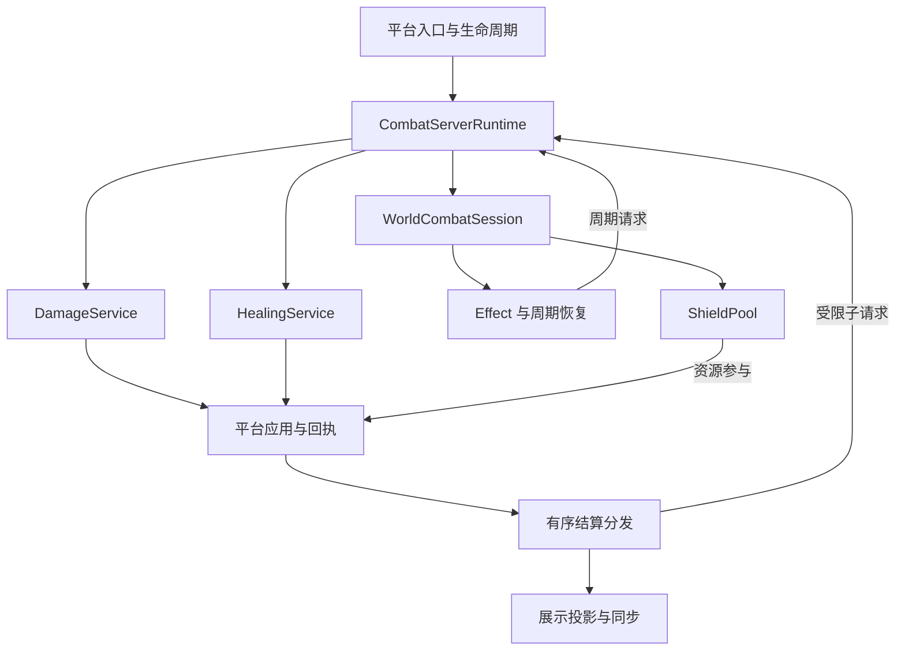

**建议把下一轮更新定位为：保留现有伤害核心，完成统一战斗运行时的接入，并收紧原版接管、定义发布和来源身份这三处边界。**

当前代码已经具备较完整的伤害框架基础，正在向 CombatNexus 的统一战斗框架迁移。最需要推进的是让已经写出的治疗、护盾、恢复、Effect 和面板服务，真正连接到游戏生命周期与实际应用结果。

完整报告已整理好，包含源码定位、目标架构、六阶段更新路线和 AutoJS 验收矩阵：

[CombatNexus 源码评估与目标架构](https://chatgpt.com/space/page_04a4d66219a48191bfa7ec4618d8bfba)

下面给出主要判断。

## 一、当前架构处于什么阶段

### 1. 伤害系统已有可保留的核心

现有实现中，有几项方向是正确的：

- **计算与实际结算分开。** 管线产生计算结果，平台层围绕 `hurtServer` 跟踪实际应用，再发布结算。
- **归因角色有明确区分。** `directEntity`、`logicalAttacker`、`effectOwner`、`equipmentOwner` 为投射物、代理攻击、召唤物和装备来源保留了扩展空间。
- **派生请求已有共享约束。** 配额、因果链、回调期间有效的父权限和迭代完成队列，已经形成一套可复用的执行机制。
- **属性、公式与贡献记录已有分离基础。** 属性读取保留原版最终值和 modifier 明细；数值公式可以独立计算；规则执行有结构化贡献记录。

这些都值得继续使用。对应实现可见 CombatServerRuntime.java[CombatServerRuntime.java](sandbox:/workspace/scratch/7ac351d3f01a/source/common/src/main/java/io/github/naimjeg/combatnexus/combat/api/CombatServerRuntime.java)、DamageAttribution.java[DamageAttribution.java](sandbox:/workspace/scratch/7ac351d3f01a/source/common/src/main/java/io/github/naimjeg/combatnexus/combat/damage/api/damage/DamageAttribution.java) 和 LivingEntityDamageSettlementMixin.java[LivingEntityDamageSettlementMixin.java](sandbox:/workspace/scratch/7ac351d3f01a/source/targets/neoforge-26.1.2/src/main/java/io/github/naimjeg/combatnexus/combat/damage/platform/mixin/LivingEntityDamageSettlementMixin.java)。

### 2. 世界级战斗服务尚未接入游戏

这是当前完成度上最重要的判断。

`CombatRuntime` 已经组装了治疗、护盾、恢复、Effect 和面板服务，但本次源码包没有找到：

- 创建 `CombatRuntime` 的平台调用；
- 对它执行 `beginTick()`、`tickRecovery()` 的生命周期接线；
- `HealingApplicationPort` 的实际平台实现；
- 消费 Effect 变更、安装与撤销属性贡献的适配器；
- 把护盾预留和提交接入实际伤害应用的代码。

根入口目前只创建 `DamageModule`。因此，**这些新领域已有实现骨架与接口合约，端到端的游戏行为还没有完成。** 依据：CombatNexusNeoForge261.java[CombatNexusNeoForge261.java](sandbox:/workspace/scratch/7ac351d3f01a/source/targets/neoforge-26.1.2/src/main/java/io/github/naimjeg/combatnexus/platform/CombatNexusNeoForge261.java)、CombatRuntime.java[CombatRuntime.java](sandbox:/workspace/scratch/7ac351d3f01a/source/common/src/main/java/io/github/naimjeg/combatnexus/combat/api/CombatRuntime.java)。

需要区别的是，**服务器级 `CombatServerRuntime` 已经实际参与伤害准入与结算，而且有停止清理链。** 它并非占位类。当前缺口主要在世界级服务装配及跨领域应用。

| 领域 | 当前状态 | 下一步重点 |
|---|---|---|
| 伤害 | 已有计算、应用跟踪、结算与扩展流程 | 收紧原版接管、事实输入和扩展权限 |
| 服务端执行内核 | 已接入配额、因果链、完成队列与停服清理 | 明确内部 API，供其他领域复用 |
| 属性 | 已注册、读取并生成来源明细 | 统一采样服务与版本语义 |
| 治疗、吸血 | 有请求、公式、回执接口与请求规划 | 接入真实治疗流程 |
| 护盾 | 有池、预留、提交、释放等实现 | 明确应用位置与资源参与语义 |
| 恢复、Effect | 有状态和调度逻辑 | 接入 tick、实际贡献与生命周期撤销 |
| 展示 | 有跳字、假人编辑、规则 tooltip | 补模板效果同步和通用面板 |

## 二、应该优先处理的具体问题

以下“确认”指可以从源码调用路径确定；本次没有完成游戏内复现。

### 1. 绕过 CombatNexus 的攻击仍会被去掉原版暴击

**优先级：P1，当前行为缺陷。**

`VanillaCritHandler` 无条件执行：

```java
event.setDamageMultiplier(1.0f);
```

但伤害入口遇到 `combatnexus:bypasses_combatnexus` 标签时，会直接跳过新管线。

因此，把 `minecraft:player_attack` 加入这个标签后，跳劈暴击仍然先被去除倍率，后续又不会进入重建流程。问题来自两个入口分别决定“是否抑制原版贡献”和“是否接管伤害”。

**更新方向：建立共同的原版接管策略。** 同一次动作的观察、贡献抑制和贡献重建，必须使用同一个接管结论。暴击、附魔、药效、护甲和特殊攻击都应明确由谁负责计算。

依据：VanillaCritHandler.java[VanillaCritHandler.java](sandbox:/workspace/scratch/7ac351d3f01a/source/targets/neoforge-26.1.2/src/main/java/io/github/naimjeg/combatnexus/combat/damage/platform/event/VanillaCritHandler.java)、DamageSourcePolicy.java[DamageSourcePolicy.java](sandbox:/workspace/scratch/7ac351d3f01a/source/common/src/main/java/io/github/naimjeg/combatnexus/combat/damage/core/pipeline/DamageSourcePolicy.java)。

### 2. 两个不同外部装备槽可能被当成一个来源

**优先级：P1，当前行为缺陷。**

`RuleExecutionContext` 已保存：

- `externalProviderId`
- `externalSourceKey`
- `slotSemantic`

但 `DamageRuleStackingResolver` 的来源签名没有使用这些字段。

具体场景是：同一实体左右戒指槽各有一件同种物品，两个来源分别是 `example:ring/left` 和 `example:ring/right`，提供相同组的 `UNIQUE_SOURCE` 规则。收集阶段保留两份，堆叠阶段却可能把它们折叠为一份。

**短期修复是补齐来源键；中期应该提取统一的 `ContributionSourceRef`。** 由收集层确定来源身份，让堆叠、贡献记录、撤销和展示共同使用，避免各层重新拼接身份。

依据：DamageRuleStackingResolver.java[DamageRuleStackingResolver.java](sandbox:/workspace/scratch/7ac351d3f01a/source/common/src/main/java/io/github/naimjeg/combatnexus/combat/damage/core/rule/DamageRuleStackingResolver.java)、RuleExecutionContext.java[RuleExecutionContext.java](sandbox:/workspace/scratch/7ac351d3f01a/source/common/src/main/java/io/github/naimjeg/combatnexus/combat/damage/api/rule/RuleExecutionContext.java)。

### 3. 数据包重载可能使旧装备效果停止生效

**优先级：P1，当前行为缺陷。**

当前重载流程大致是：

1. 通道发布新版本。
2. 模板和规则分别校验、分别发布。
3. 某一部分失败时，保留它自己的旧快照。
4. 旧快照与新通道版本不一致，执行时被禁用。

一个明确场景是：**同一次重载新增合法通道，同时让某模板的文件 ID 与定义 ID 不一致。**

通道成功更新，模板验证失败。旧模板虽然还在内存里，但不再具有执行权威，依赖模板引用的装备效果会停止执行。内联在物品里的规则则可能继续生效。

这里需要保证的是**上一整代可用定义的保留**。建议引入：

```java
record CombatDefinitionSnapshot(
    long generation,
    FormulaSettings formulas,
    ChannelCatalog channels,
    RuleProgram globalRules,
    TemplateCatalog templates
) {}
```

这是目标结构示意。所有候选数据基于同一候选通道集合完成校验和编译，全部成功后一次发布；失败则继续使用上一整代。

依据：DamageChannelRegistry.java[DamageChannelRegistry.java](sandbox:/workspace/scratch/7ac351d3f01a/source/common/src/main/java/io/github/naimjeg/combatnexus/combat/damage/core/registry/DamageChannelRegistry.java)、DatapackDamageTemplateReloadListener.java[DatapackDamageTemplateReloadListener.java](sandbox:/workspace/scratch/7ac351d3f01a/source/common/src/main/java/io/github/naimjeg/combatnexus/combat/damage/core/template/DatapackDamageTemplateReloadListener.java)、DamageTemplateRegistry.java[DamageTemplateRegistry.java](sandbox:/workspace/scratch/7ac351d3f01a/source/common/src/main/java/io/github/naimjeg/combatnexus/combat/damage/core/template/DamageTemplateRegistry.java)。

### 4. 条件返回 false，也可能已经修改伤害

**优先级：P1，扩展 API 契约缺陷。**

`DamageRuleCondition.test()` 和 `DamagePhaseProcessor.canHandle()` 都接收可变的 `DamageRuleContext`。

当前保护逻辑只在抛异常时回滚，正常返回 `false` 时不回滚。于是，在允许增加基础伤害的阶段，一个扩展条件可以：

```java
ctx.tryAddBaseDamage(ctx.getInitialChannel(), 100, "example:condition");
return false;
```

最终规则被判为条件不成立，但伤害已经改变。内置条件中没有发现主动利用这种行为，不过对外 API 已允许它发生。

建议把三种能力分开：

| 扩展入口 | 应有能力 |
|---|---|
| Condition、canHandle | 查询只读事实 |
| Provider | 提交候选规则和来源 |
| Operation、Processor | 通过受控接口提交计算贡献 |

仅把参数换成现有 `DamageContextView` 还不充分，因为它仍返回活的 `LivingEntity`。可以先隔离框架 mutation 权限，再逐步将规则需要的数据转成不可变事实。

依据：DamageRuleCondition.java[DamageRuleCondition.java](sandbox:/workspace/scratch/7ac351d3f01a/source/common/src/main/java/io/github/naimjeg/combatnexus/combat/damage/api/rule/DamageRuleCondition.java)、DamageRuleExecutor.java[DamageRuleExecutor.java](sandbox:/workspace/scratch/7ac351d3f01a/source/common/src/main/java/io/github/naimjeg/combatnexus/combat/damage/core/rule/DamageRuleExecutor.java)。

### 5. 护盾抵扣不应让已获准的伤害在应用中途再次准入失败

**优先级：P1，接线前必须解决。**

当前护盾 `reserve()` 在伤害应用阶段创建 `SHIELD` 子 lineage，并再次申请共享额度。

如果本 tick 只剩一个额度：

- 伤害准入成功；
- 护盾抵扣再申请额度；
- 额度不足，抛异常。

即使没有可用护盾，也会先走这次准入，因为扫描池发生在后面。

**护盾抵扣应作为同一次伤害应用的资源参与步骤。** 吸血、反伤、独立授盾可以提交新的请求；必要的抵扣使用已经获准的 application 权限。如果需要限制内部工作量，应在开始可变应用前完成预留。

当前护盾没有实际接入伤害，所以不能说它已经造成线上问题，但不能直接把现有 `reserve()` 塞进伤害处理器。

依据：DefaultShieldService.java[DefaultShieldService.java](sandbox:/workspace/scratch/7ac351d3f01a/source/common/src/main/java/io/github/naimjeg/combatnexus/combat/shield/internal/DefaultShieldService.java)。

### 6. 模板效果缺少玩家可见的展示

**优先级：P2，功能缺口。**

当前 tooltip 正常展示内联 `entries`、`affixes`，模板引用主要显示在 debug 区域；没有同步服务端解析后的模板效果。

结果是，仅使用模板引用的装备可以在服务器生效，但玩家无法正常查看它提供的效果。

建议同步 `ItemCombatPresentationSnapshot`：服务端给出解析后的条目、来源、条件、效果和版本，客户端继续使用现有文档规划器与渲染器。

依据：ItemDamageRuleTooltip.java[ItemDamageRuleTooltip.java](sandbox:/workspace/scratch/7ac351d3f01a/source/common/src/main/java/io/github/naimjeg/combatnexus/combat/damage/client/tooltip/ItemDamageRuleTooltip.java)、DamageTooltipRenderer.java[DamageTooltipRenderer.java](sandbox:/workspace/scratch/7ac351d3f01a/source/common/src/main/java/io/github/naimjeg/combatnexus/combat/damage/client/tooltip/DamageTooltipRenderer.java)。

## 三、建议的目标架构

核心结构应是：**服务器级执行内核、世界级状态服务、并列领域计算、统一平台应用边界。**



图中表示组织与调用关系。定义版本和参与者事实由应用层在计算前固定，再交给相应领域。

### 各层应该负责什么

| 边界 | 主要职责 | 生命周期 |
|---|---|---|
| 扩展注册 | 处理器、codec、属性定义、展示描述器；冻结与确定性排序 | Mod 进程 |
| 定义快照 | 通道、公式、全局规则、模板及引用关系 | 每个服务器，按重载发布版本 |
| 执行内核 | 准入、因果链、回调权限、请求去重、完成队列 | 每个服务器 |
| 世界会话 | Effect 实例、护盾池、恢复计划、实体缓存、关闭状态 | 每个世界会话 |
| 领域服务 | 伤害、治疗、护盾、Effect 各自的计算与操作合约 | 所属服务器或世界 |
| 平台适配 | 原版采样、事件、Mixin、真实应用、生命周期 | 当前 NeoForge target |
| 展示服务 | 服务端事实投影、网络同步、客户端缓存与渲染 | 连接与世界会话 |

这套边界可以先通过包和接口实现。当前 `common` 已经隔离了直接 NeoForge 导入，继续保持共享源码方式即可；其中依赖 Minecraft 的业务代码也有合理位置。暂时没有必要为了目录整齐，先拆出大量 Gradle 子项目。

### 组合根应该从伤害模块上移

根入口最终应负责装配：

- 属性注册与事实服务；
- 伤害模块；
- 治疗模块；
- Effect 与贡献适配；
- 服务器和世界生命周期；
- 展示与网络。

`DamageModule` 则专注伤害领域。这样新增恢复、治疗或控制能力时，可以直接找到自己的所有者和接入点。

## 四、比目录结构更重要的五项合约

### 1. 同一次计算固定哪些事实

当前属性已经在上下文建立时冻结，但装备按阶段重读，部分条件与减伤逻辑仍读取实时生命和 Effect。扩展回调改变状态时，就可能形成“属性是前一个时点，装备与 Effect 是后一个时点”的混合输入。依据：DamageModuleContext.java[DamageModuleContext.java](sandbox:/workspace/scratch/7ac351d3f01a/source/common/src/main/java/io/github/naimjeg/combatnexus/combat/damage/core/pipeline/DamageModuleContext.java)、ItemDamageRuleProvider.java[ItemDamageRuleProvider.java](sandbox:/workspace/scratch/7ac351d3f01a/source/common/src/main/java/io/github/naimjeg/combatnexus/combat/damage/builtin/rule/provider/ItemDamageRuleProvider.java)。

目标应明确区分：

| 数据 | 取得或变化时机 |
|---|---|
| 定义 generation | 请求进入执行时固定 |
| 参与者、属性、装备、Effect、条件所需生命事实 | 原版采样和贡献协调后，正式计算前捕获 |
| 当前伤害组成、phase、暴击结果 | 在管线内按阶段变化 |
| 实际损血、回血、吸收与护盾消耗 | 在应用边界记录 |

**同一个 tick 不代表事实没有变化。** 后一笔请求应该看到前一笔已提交的效果。

吸血等派生请求继承因果链与额度，但必须重新采样参与者事实，尤其是攻击者当前血量和治疗修正。

### 2. 世界状态由谁写入

建议明确以下所有权：

- 原生生命、吸收和生死流程由原版执行，平台适配器协调并生成应用回执。
- 属性最终值由原版 `AttributeMap` 提供；框架保留来源明细。
- 自定义护盾余额由世界护盾服务持有。
- 原版 Effect 默认保持观察模式。
- Managed Effect 由唯一适配器安装和撤销贡献。
- 自定义恢复器只负责自己的计时，到期提交治疗请求。

现有 `VANILLA_OBSERVED` 与 `MANAGED` 区分可以继续使用。它需要通过实际接线保证“一份贡献只有一个执行者”。

### 3. 来源、归因和因果链各有含义

建议保留三种独立身份：

- **`CombatLineage`**：这笔操作由哪笔操作派生。
- **`DamageAttribution`**：直接实体、逻辑攻击者、Effect owner、装备 owner 分别是谁。
- **`ContributionSourceRef`**：哪件装备、哪个槽位、哪个施法实例提供了贡献。

这会同时解决装备去重、Effect 多来源叠加、准确撤销和面板说明的问题。

Effect 后续支持多个施法者或同技能多个实例时，来源不能只靠一个效果定义 `Identifier`。当前服务按 `(target, effect, source)` 管理，接入时应补齐来源实例语义。依据：DefaultEffectService.java[DefaultEffectService.java](sandbox:/workspace/scratch/7ac351d3f01a/source/common/src/main/java/io/github/naimjeg/combatnexus/effect/internal/DefaultEffectService.java)。

### 4. 事务需要明确不可撤销的应用边界

这里的事务应保证受控执行和正确发布。原版及其他模组的全部副作用，无法仅靠恢复几个字段就保证回滚。

需要区分：

1. **提交前失败**：释放预留，返回明确拒绝原因。
2. **已确认发生写入**：保留实际事实，产生完整或部分应用回执。
3. **无法确认是否写入**：标为未知，禁止自动重试。
4. **结算通知失败**：不改变已经发生的应用结果。

另外，整个 `hurtServer` 调用前后的净生命差，可能混入嵌套回血或扣血。适配器应在具体应用边界采集证据；只能得到观察值时，就明确标记其完整性。

### 5. 护盾全吸收要有独立的成功判定

护盾接线前，必须确定它与护甲、格挡、原版吸收之间的顺序，以及最后允许取消的位置。

至少保证：

- 提交前取消：释放预留，不扣盾；
- 有效攻击被全部吸收：提交护盾消耗，生命损失为零；
- 生命损失为零：按吸血策略不触发吸血；
- 已发生写入后异常：保留已发生的资源变化事实。

**不能只依靠 `hurtServer` 的布尔返回值判断护盾是否应该提交。** 全吸收时传给原版的剩余伤害可能为零，需要额外的可靠提交依据。

## 五、具体更新顺序

建议按下面六个阶段推进，每阶段都有可观察的完成标准。

| 阶段 | 更新内容 | 完成标准 |
|---|---|---|
| **1. 修正现有路径** | 暴击接管一致性、外部来源键、谓词修改隔离 | bypass 保留原版暴击；不同来源分别生效；false 条件不改变伤害 |
| **2. 统一定义发布** | 候选构建、交叉校验、编译、整代发布 | 失败重载保留旧 generation 和旧行为 |
| **3. 接入世界运行时** | 创建、tick、实体离开、死亡、重生、换维度、卸载；真实治疗端口 | 治疗请求实际生效并产生回执，旧会话引用失效 |
| **4. 打通跨域流程** | 伤害结算接吸血；统一事实采样；接一个 managed Effect | 吸血按实际损血计算；Effect 只加成一次，能准确撤销 |
| **5. 接入护盾和恢复** | 资源参与、全吸收提交、周期恢复调度 | 配额边界不破坏已准入操作；取消不扣盾；恢复不重复计时 |
| **6. 完成展示与运行质量** | 模板展示、角色面板、会话化协议、采样完整性与性能优化 | 远程客户端展示一致；旧消息被拒绝；优化有测量依据 |

第三阶段先用**一个简单治疗请求**验证“请求 → 平台应用 → 实际回执 → 结算”，再接吸血，会更容易定位问题。

第四阶段的 Effect 先选一个单纯属性加成，完整覆盖：

**申请、替换、过期、驱散、死亡、换维度和卸载。**

这条流程完成后，再增加持续伤害、复杂控制或更多技能类型，已有边界才会真正发挥作用。

## 六、验证与性能方向

项目的 AGENTS.md[AGENTS.md](sandbox:/workspace/scratch/7ac351d3f01a/source/AGENTS.md) 明确要求后续行为验证采用 AutoJS。建议首先把上述问题转成回归场景，重点覆盖：

- bypass 暴击与两外部槽来源；
- 新通道加坏模板的失败重载；
- 取消、零损血、满血治疗；
- 全护盾吸收与额度边界；
- 嵌套应用的结果归因；
- Effect 多来源撤销；
- 死亡、重生、换维度和旧消息；
- 专用服务器与远程客户端的模板展示。

性能方面，源码能确认存在两个值得测量的开销来源：每次伤害枚举全部注册属性并复制 modifier 明细，以及大量谓词、处理器和操作前的状态 checkpoint。**目前没有测量依据把它们判定为实际瓶颈。** 先收紧只读边界，再考虑按定义版本预编译规则、按明确需求采样属性，可以同时降低回滚复杂度和分配量。依据：AttributeReader.java[AttributeReader.java](sandbox:/workspace/scratch/7ac351d3f01a/source/common/src/main/java/io/github/naimjeg/combatnexus/attribute/api/AttributeReader.java)、DamageModulePipeline.java[DamageModulePipeline.java](sandbox:/workspace/scratch/7ac351d3f01a/source/common/src/main/java/io/github/naimjeg/combatnexus/combat/damage/core/pipeline/DamageModulePipeline.java)。

**本次验证范围：**完成了静态架构与关键调用链审查，没有修改源码。构建尝试先遇到 `gradlew` 的 CRLF 行尾问题，直接调用 wrapper 后又因无法解析 `services.gradle.org` 停在 Gradle 下载阶段；当前环境 Java 21，项目要求 Java 25。因此尚未进入源码编译，也没有完成 Minecraft、Mixin 或性能运行验证。报告正文与结构已回读核对，页面视觉渲染未实测。