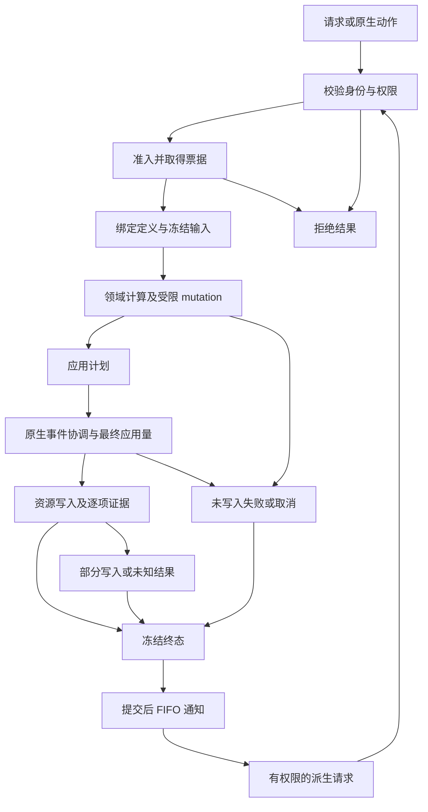

# CombatNexus 语义所有权与事务管线架构

状态：已实施（2026-11-04）。O1–O10 及配套 A1–A6 已完成 common 与 NeoForge 26.1.2 / Java 25 的接线、旧入口清理和运行验证。比较基线为 HEAD `7d9be3d`；只读 `docs/DamageNexus-main` 未作为编译输入或修复目标。

本文规定语义、权限、写入和失败责任；[冷热数据隔离架构](HOT_COLD_ARCHITECTURE.md) 规定同一次捕获的数据布局、代际和投影。第 6 节对应原越界清单，第 7 节记录实际验证。未启用 1.21.1，不承诺数据库事务原子性、持久去重或旧 API/存档兼容。

## 1. 架构判断

实现沿用既有事务组件：`CombatServerRuntime` 已共享准入预算和完成 FIFO，damage 已有计算工作区、原生写入证据和结算发布门禁，healing/shield 已使用共同内核。本轮将分散在平台事件、领域服务和公开机制 API 中的职责收敛到下面的所有权边界。

当前采用“服务器执行内核 + 世界领域服务 + 领域专用管线 + 原生应用端口”。共享内核只管理权限、预算、阶段和通知；damage 决定伤害，healing 决定治疗，shield 决定护盾，regeneration 决定何时提出治疗，effect 决定效果生命周期。跨域联动放在显式组合策略中，不让 healing 解释所有伤害状态，也不让 target 决定战斗规则。

这里的事务是同步、有因果关系、有写入证据的游戏操作，不是数据库 ACID 事务。多个资源写入之间可能触发原版或其他模组回调；不能承诺护盾、生命、Effect 和所有监听器副作用一起回滚。

## 2. 所有权合约

语义 owner 负责定义输入有效性、执行顺序、来源归属和结果含义；状态 owner 负责唯一可变存储及生命周期；写入 owner 负责提交副作用并提供证据。三者可以通过合约协作，但同一项收益不能有两个执行 owner。

| 能力 | 语义与状态 owner | 唯一写入边界 | 其他模块可获得的合约 |
| --- | --- | --- | --- |
| 事务因果、预算、派生权限、完成 FIFO | 服务器 `combat.internal.transaction` | 内核的准入/终结操作 | 业务提交入口、只读 lineage、短期 `CombatParent` |
| 实体会话与服务组合 | 世界 `CombatRuntime` | 装配与生命周期协调器 | 带 session 的服务句柄，不开放任意 reset |
| 属性定义、单位、原版映射、来源快照 | `attribute` | 原版属性端口；effect 提交来源贡献计划 | 同一 revision 的值与来源视图 |
| 生命、装备、Effect 等请求事实组合 | `combat` 输入层；子事实由对应域提供 | 捕获器，不写战斗资源 | `CombatInputFrame`，不能用 ID 恢复写权限 |
| 数值公式 | `formula` | 无外部写入 | 确定性函数；不读实体、不抽随机数、不发布事件 |
| 伤害通道、暴击决策、减伤归属、应用顺序 | `combat.damage` | damage 应用协调器经原生端口提交 | 伤害请求、受限 mutation、结算与证据 |
| 独立护盾池及抵扣/破裂/恢复 | `combat.shield` | 护盾服务的授予/移除/恢复及 reservation 提交 | 护盾快照；damage 持有受限参事务句柄 |
| 治疗修正、实际恢复、溢出分类 | `combat.healing` | 治疗原生端口写一次生命 | 独立治疗请求及 settlement |
| 自定义恢复计时、受伤延迟、战斗状态 | `combat.regeneration` 的世界状态 | 调度器只提交 healing | 条件事实与计划；不写生命 |
| Effect 来源、叠加、过期、贡献计划与撤销 | `effect` | 贡献应用端口 | EffectFacts、ChangePlan、应用回执 |
| 吸血等跨域因果策略 | `combat` 组合策略 | 调用领域服务，不写领域内部状态 | 已确认 damage 证据 → healing 子请求 |
| 展示、解释、诊断 | `presentation` / damage 专用展示 | 有界 DTO 投影与平台传输 | 只读权威事实，不重算收益 |
| 原生事件顺序、实体解析、Mixin、网络 | target | 版本绑定端口实现 | 原始观察及写入证据，不拥有通用业务公式 |

不能因为 common 允许 Minecraft 类型，就把所有实体读写都放到任意域；也不能因为一段逻辑接触事件，就把其业务规则留在 target。只有已证实的平台差异留 target。原版属性收益由原版执行时，effect 只观察；接管贡献必须先明确撤销旧 owner。

当前目录分工：`combat.api` 只保留业务入口和不可变值；`combat.internal.transaction` 保存内核；`combat.spi` 提供可信适配器所需的窄入口；`combat.internal.coordination` 保存跨域策略。各域保留自己的 api/internal，target 仅装配 SPI。各域沿用现有执行器，没有制造第二套内核。公开 Java API 允许破坏性变更，不增加旧包门面或版本握手。

## 3. 三种生命周期与权限

注册定义属于模组注册周期；成功采用的 datapack generation 属于服务器；效果、护盾、恢复计划、面板缓存属于世界实体会话。它们不能共用一个静态“当前上下文”。线程只证明可以访问，不能充当服务器或世界的身份。

服务器内核持有定义仓库、预算、提交身份和通知队列。世界 Runtime 持有实体服务和 sessionId。请求持有一个定义句柄、输入帧、领域工作区及写入日志。跨世界操作必须显式解析对应世界服务；不得拿同 UUID 或同线程替代会话校验。

业务 API 不提供自行创建 APPLICATION scope、绑定 lineage、伪造 receipt 或直接 enqueue 的能力。`AdmissionTicket` 由内核签发，绑定 server、session、操作、请求与阶段；`ApplicationPermit` 只能在有效票据上取得。`CombatParent` 仍仅在注册回调作用域内有效，退出回调即失效；快照、damageId、generation、数字父 ID 均不是权限。

可信 target SPI 可以报告原生入口和写入观察，但必须通过协调器验证事件身份和阶段；`Internal` 注解不是运行时权限校验，也不是对恶意 Java 模组的沙箱。目标是阻止正常扩展误用以及内部调用链错误，不承诺隔离任意 JVM 代码。

世界服务的 gameplay 写入口与生命周期清理入口分开。效果安装/撤销、护盾移除等需要明确的世界写入阶段；计算回调中拒绝这类服务写入，结算联动经回调权限提交。tick 到期与卸载清理使用生命周期权限，不伪造一个伤害根请求；effect 生命周期不强行塞进 damage 的数值流水线。

## 4. 事务状态机与提交边界



1. **校验与准入。** 校验服务器线程、世界会话、目标、请求身份、来源和父权限。原生动作与公开请求汇合到同一准入内核；每个独立操作只计一次额度。必须保持同步返回；不能把计算或真实写入排到下一 tick 再返回成功。首次提交在作用域/线程拒绝之前消耗身份；被拒后不可重提同一请求。damage 按对象身份去重，healing 在服务器共享 UUID 门禁去重；均不是持久记录。通知信封容量在扣根链/tick 额度和资源写入之前预留，damage 两槽（本体及参事务护盾），其他操作一槽。容量不足明确拒绝且不消耗准入额度。
2. **捕获。** 完成必要世界 tick 协调，在扩展计算回调前消费入口已经捕获的完整 definition generation，捕获参与者属性、装备、生命、Effect 事实及来源。相同 tick 的后续请求重新采样。面板当前查询可以另行捕获，但一份面板内不得混用未来状态。
3. **计算。** 只修改领域工作区。damage 保持 BASE_MODIFICATION → TYPE_SCALING → 属性缩放 → 暴击决策/CRITICAL_HIT → CONDITIONAL_MULTI → GLOBAL_ADJUSTMENT → 攻击量冻结 → MITIGATION_SETUP → 防御计算 → FINAL_OVERRIDE 的现有顺序。公式抽取不改变真伤、转换、随机消耗或原版减伤 owner。
4. **准备应用。** 生成不可变 `DamageApplicationPlan` / `HealingApplicationPlan` 等领域计划。写回 Incoming 事件数值只是交接计算结果，不是生命已提交；外部 Pre 回调仍可能改量或取消。最终应用边界上的新观察另存到应用输入与 journal，不修改已冻结计划或计算输入。
5. **应用与证据。** damage 在全部 Pre 回调后抵扣独立护盾，再进入原版吸收与生命写入。护盾 reserve 尚未改变余额，commit 后不可因后续生命写入失败而回滚。healing 在原生治疗事件后采样生命，再写入一次；事件前后整体差值不能充当该次写入证据。
6. **终结。** 领域协调器为已准入操作冻结终态，保存已知写入及未知部分。用终结门禁防止重复结束；完成通知容量必须在提交前获得保障，不能等资源已写入才发现无法登记结果。计划、写入日志、业务 settlement 是三个对象，不以一个可变 Context 同时表示三者。
7. **通知。** 退出所有可变作用域后排空服务器 FIFO，按现有优先级与稳定顺序通知。监听器异常不回滚资源，也不重复投递；子请求可同步完成写入，其通知追加至 FIFO，不能递归插队。这里保证单进程存活会话内的一次终结/至多一次发布，不承诺进程崩溃后的持久化 exactly-once。

原生伤害已经进入 hurt 调用栈才获得完整伤害身份，因此第 1–4 步需要适配原生 continuation，不能要求所有入口先在栈外生成计划再调用 hurt。保留现有 hurt 栈关联与 Incoming/Pre/Post 采样，状态转换由领域应用与终结协调器管理。

### 失败结果

| 时点/事实 | 领域结果与必须行为 |
| --- | --- |
| 未准入、父权限过期、重复请求 | 返回拒绝，不写资源；记录具体原因，不生成成功通知 |
| 工作区 mutation 失败且未进入资源应用 | 只恢复该工作区 checkpoint；维持严格/宽松回调错误策略，不声称撤销外部实体副作用 |
| 原生事件取消且尚无写入 | 取消/未应用，释放未提交 reservation |
| 护盾已提交，后续生命写入失败 | 保存 shieldLoss；标记应用未完成，不归零、不返还护盾、不自动重试 |
| 生命写入抛错但有确认的变化 | 保存确认量并标记部分完成；没有足够证据则 UNKNOWN，不推断没有发生写入 |
| 全护盾吸收 | 伤害 APPLIED，生命损失为零；不能触发按生命损失计算的吸血 |
| 回调、投影、日志失败 | 保留已冻结结果，隔离观察失败；不重跑计算、不补抽随机数 |

统一的是上述事实模型，不是强制所有域共用一个结果枚举。现有 damage 的 `APPLIED + applicationCompleted=false` 与 healing 的 `PARTIAL/UNKNOWN` 通过各自证据映射，不能仅凭 APPLIED 判断完整成功。`ApplicationJournal` 保存资源种类、写前/写后值、确认量、观察点及完成标志；保留原版吸收整体观察与原生生命写入证据的区别，不能给未捕获的吸收写入伪造精确证据。

护盾参事务使用专用 permit，绑定本次 damage、世界和目标，复用已准入额度；独立授盾/抵扣仍单独准入。父子请求是因果链，不是同一可回滚事务：子治疗失败不撤销父伤害，父回调结束后不能保存权限稍后提交。

## 5. 跨域策略与 Effect 应用

吸血策略读取完整主伤害的已确认生命损失、捕获时的 lifesteal 比率、触发策略和有效攻击者，排除吸收、护盾、派生及反伤。它只负责生成 healing 子请求；治疗域只认识请求原因、来源和治疗输入。请求保留父链预算，治疗 received 修正消费一次。吸血策略从 healing API 移到 combat 组合层，不改变当前公式与筛选规则。

恢复域持有最后确认受伤时间及战斗窗口策略，target 只提供实体存活、游戏规则、时钟等原生事实。当前 100 tick 战斗窗口先作为显式默认策略迁移；恢复计划自己的 damageDelayTicks 仍独立，不能在迁移时合并成一个常量。取消、满血或失败不积累补偿爆发，继续保持自定义恢复与原版食物/再生 Effect 分离。

Effect 应用改为 `prepare(ChangePlan) → apply → ContributionReceipt → reconcile`。effect 决定来源身份、刷新/升级和需要撤销/安装的集合；attribute 贡献端口负责原版属性映射与安装；target 只实现真实 API 差异。prepare 检查目标、属性、重复来源和执行能力，不提前改实体。

应用回执逐项记录实际撤销和安装。若平台写入中途失败，effect 不得仅保留旧 active 表并假定实体也未变：进入待协调状态，使用安装账本恢复一致性，暂停受影响来源的进一步变更，记录可重入的清理步骤。只有确定可补偿的属性安装操作才做补偿；不得把此机制推广成伤害生命回滚。未实现的动作限制继续拒绝；observed vanilla Effect 不安装第二份 modifier。

## 6. O1–O10 实施对照

| 项目 | 当前落点及合约 |
| --- | --- |
| O1：恢复业务状态 | [DefaultRegenerationScheduler](../common/src/main/java/io/github/naimjeg/combatnexus/combat/regeneration/internal/DefaultRegenerationScheduler.java) 持有确认受伤时间与显式 100 tick 战斗窗口；CombatSettlementPolicies 在 common 判定实际损失并转交恢复域；damageDelayTicks 独立。target 只提供存活、时间和 natural regeneration 规则事实。 |
| O2：组合事实 | CombatEntityFacts 迁到 combat.api.input；EffectFacts 归 effect。每参与者 CombatInputFrame 持有 session/维度/UUID/revision/tick/generation；武器所有者也参与捕获。全属性范围与装备/Effect 副本语义保留。 |
| O3：治疗政策与写口 | [DefaultHealingService](../common/src/main/java/io/github/naimjeg/combatnexus/combat/healing/internal/DefaultHealingService.java) 捕获属性、计算倍率并生成 HealingApplicationPlan，分类实际治疗/溢出/失败。[WorldHealingPort](../targets/neoforge-26.1.2/src/main/java/io/github/naimjeg/combatnexus/combat/platform/WorldHealingPort.java) 保留原生事件后采样及唯一生命写入，返回原始 Receipt；目标失效在写前拒绝。 |
| O4：Effect 回执协调 | [EffectContributionPort](../common/src/main/java/io/github/naimjeg/combatnexus/effect/api/EffectContributionPort.java) 提供 prepare/apply/reconcile 与逐项回执。[EffectAttributeContributions](../common/src/main/java/io/github/naimjeg/combatnexus/attribute/internal/EffectAttributeContributions.java) 核对实际 modifier 并维护安装账本，写入后抛错也能补偿；effect 仅在完整回执后提交 active。待协调只阻塞对应 target/effect/source，其他来源可继续。旧 target ManagedEffectExecutor 已删除；稳定 modifier ID 算法保留。 |
| O5：计算与应用分离 | DamageModulePipeline 返回不可变 DamageApplicationPlan；[DamageApplicationCoordinator](../common/src/main/java/io/github/naimjeg/combatnexus/combat/damage/core/pipeline/DamageApplicationCoordinator.java) 交接 Incoming。计划包含 offensiveTotal 和 generation，诊断异常隔离，不再由计算管线直接写事件。Incoming 交接与真实 native commit 仍是两个时点。 |
| O6：权限收窄 | [CombatServerRuntime](../common/src/main/java/io/github/naimjeg/combatnexus/combat/internal/transaction/CombatServerRuntime.java)、scope、budget、queue、publication/submission gates 已移入 internal。AdmissionTicket/ApplicationPermit 构造器私有，ticket 绑定真实 server/world Runtime/target；关闭、卸载或会话替换后失效。native continuation 先绑定原生身份，再授权本次 admitted damage。业务 API 没有 scope 创建入口。[CombatWorldLifecycleAccess](../common/src/main/java/io/github/naimjeg/combatnexus/combat/spi/CombatWorldLifecycleAccess.java) 提供短期生命周期 Permit；服务不能用任意 reset/close 绕过清理。 |
| O7：定义所有权 | 完整 settings/channels/rules/templates Snapshot 属服务器内核；所有执行查询显式传 server 或请求句柄，删除隐式 current/bind。成功资源采用才发布，旧 generation 不能覆盖新版本；玩家登录只同步已采用设置，不重新发布 retained candidate。 |
| O8：吸血组合 | [LifestealRequests](../common/src/main/java/io/github/naimjeg/combatnexus/combat/internal/coordination/LifestealRequests.java) 迁到 combat 组合层；筛选条件、比例上限及父授权保持，healing API 不解释伤害策略。 |
| O9：面板投影 | common CombatPanelProjector / damage ItemPresentationProjector 决定展示；target 负责本人/容器身份、nonce、编码与发送。属性/来源/Effect/护盾捕获及 codec 均受构造预算限制；超限返回明确拒绝。 |
| O10：终结与证据 | 准入预留完成信封，ticket 释放未用槽位，清理 epoch 使旧槽位失效；监听器追加 FIFO、不递归插队。[ApplicationJournal](../common/src/main/java/io/github/naimjeg/combatnexus/combat/api/ApplicationJournal.java) 保存逐资源写前/写后、确认量、观察类别、完成标记及可选护盾来源。ShieldCommitReceipt 在后续步骤之前交给 damage；finally 终结异常路径，重复同回执幂等、冲突回执拒绝。生命确认与原版吸收 WHOLE_CALL 明确区分。 |

COMPUTE 中的 Effect 安装/撤销、护盾移除及恢复写入口均受守卫。世界服务保留实际 Runtime 身份，不能将旧服务绑定到同 Level 的新会话。生命周期清理不耗伤害额度。停止后的服务器身份有弱 tombstone，防止清理期间重新创建内核；同步 scope 栈按所有者关闭，子 COMPUTE 退出不能撤销父 native continuation 的 permit。

没有把内核 internal 包视为 JVM 安全沙箱；可信 target 仍需要内部原生适配接线。Healing/Effect 原生 writer 注入用于确定性的故障验证，正常装配使用真实原版写口；不使用反射或运行时版本分支实现产品兼容。

公开 Java API 为破坏性变更：内核包、CombatEntityFacts/LifestealRequests 落点、业务 factory 的真实世界绑定、HealingApplicationPort、Effect 贡献端口、shield commit 回执、输入/证据及显式 server 定义查询均已更新，不保留旧门面。注册与数据命名空间维持 combatnexus；新增完成容量拒绝和展示预算提示翻译，Mixin require 保持原值。

通道目录寻址修复会改变原先错误退回 untyped 的请求结果。physical 抗性 50 的固定探针为 2.32 → 1.16，详见 [冷热文档的基准说明](HOT_COLD_ARCHITECTURE.md#真实运行验证与基准)；不能把此次改造描述为完全没有数值变化。

## 7. 运行验证与复现

环境：Windows、HotSpot JDK 25.0.3、Minecraft 26.1.2、NeoForge 26.1.2.126、AutoJS 1.0.1、Rhino 2101.2.8-build.91；开发模组 spark 1.10.187、JEI 29.53.0.115、Just Enough Characters 4.6.9、MezzConfig 0.6.10。隔离世界位于活动 target 的 build/boundary-run；客户端位于 build/settings-client-run，测试玩家 SettingsVerifier。内置数据外，runner 临时安装规则/设置数据包，结束恢复；未用生产存档。

最终代码重新编译并重启服务端后，以下 **127 项断言通过**。数量按每个场景一次成功运行计，不累计重跑；没有新增 JUnit/GameTest 或专用测试 source set。原生 Effect 和 healing 故障确实写入 AttributeInstance/setHealth 后抛错，不只是模拟返回 Receipt。

| runner / 脚本 | 通过 | 实际覆盖 |
| --- | --- | --- |
| [verify-architecture-runtime.py](../scripts/verify-architecture-runtime.py)：verify-architecture.js | 15 | 提交拒绝消耗身份、同步 damage/healing、Effect 一次贡献、FIFO、同修订双视图、同 tick 重采样、捕获中预算拒绝 |
| 同 runner：verify-effect-receipts.js | 5 | 失败不提交 active、待协调来源隔离、补偿后重试、成功回执 |
| 同 runner：verify-healing-evidence.js | 4 | PARTIAL/UNKNOWN、异常传播、失败一次终结、FIFO 清空 |
| 同 runner：verify-common-boundary.js | 11 | 延迟内容句柄、21 个处理器、普通/零/负/重复伤害、hurt 栈清理 |
| 同 runner：verify-native-effect-failures.js | 7 | 第二项原生安装、刷新及撤销写后抛错；补偿恢复两项 modifier，最终移除无残留 |
| 同 runner：verify-kernel-and-resources.js | 15 | 容量拒绝、子通知 FIFO、过期槽/ticket、跨世界、计算期写入/恢复推进/治疗关闭拒绝、全护盾、journal、参事务复用额度、吸血及受疗倍率一次 |
| 同 runner：verify-recovery-and-lifecycle.js | 11 | 20 合格 tick 聚合、跳 tick 不补发、取消不重试、受伤延迟与战斗窗口独立、原生游戏规则、实际卸载/加载处理器更换世界会话 |
| 同 runner：verify-settings-snapshot.js | 4 | 新旧显式句柄、旧输入不混代、过期 generation 发布拒绝 |
| 同 runner：verify-native-healing-failure.js | 4 | setHealth 后抛错保留精确写入、无自动重试、移除目标拒绝 |
| 同 runner：verify-cold-history.js | 7 | 真正结算冻结记录、代际、session 拒绝、数量/重量/年龄淘汰及明确计数、不改生命 |
| [verify-completion-capacity.js](../scripts/autojs/verify-completion-capacity.js) | 4 | 预留真实服务器 1000000 槽位，容量不足在准入拒绝，不写生命且不扣配额，释放全部槽位 |
| [verify-combat-rules-runtime.py](../scripts/verify-combat-rules-runtime.py) | 6 | 普通/暴击、OFF/SUMMARY/FULL_TRACE 不改伤害或双方随机流、真伤绕护甲、最终取消、过量击杀只计确认生命 |
| [verify-live-player-damage.js](../scripts/autojs/verify-live-player-damage.js) | 4 | 实际客户端玩家的 Player 护盾/生命 Mixin、全吸收、来源 journal、应用完成证据 |
| [verify-architecture-client.py](../scripts/verify-architecture-client.py) | 3 | 真实客户端连接、C 键、服务端快照填充面板；在旧 retained candidate 已被替代后仍能登录 |
| [verify-presentation-runtime.py](../scripts/verify-presentation-runtime.py) | 5 | 超预算明确提示与恢复、旧 nonce 拒绝、实际换维度、死亡/重生后新面板 |
| [verify-settings-runtime.py](../scripts/verify-settings-runtime.py) | 20 | 真正成功/失败 reload、严格 JSON/范围/大小、失败保留旧伤害、公式/预算采用、登录/reload tooltip 同步及断线缓存清理 |
| [verify-definition-retention.js](../scripts/autojs/verify-definition-retention.js) | 2 | 32 份替换快照在受控 GC 后保留 0，原数据用新 generation 恢复 |

复现顺序如下（命令从仓库根执行；两个启动命令在独立终端运行）。验证 runner 针对隔离路径，端口不可同时被其他实例占用。需要图形环境执行客户端步骤；初次启动需按 Minecraft/NeoForge 正常流程接受 EULA。

```powershell
# 专用服务器（端口仅用于本地验证）
cd targets/neoforge-26.1.2
.\gradlew.bat -I ../../scripts/autojs/server.init.gradle -PverificationGamePort=25588 runServer
# 另一个终端启动客户端
cd targets/neoforge-26.1.2
.\gradlew.bat -I ../../scripts/autojs/client.init.gradle runClient
# 以下从仓库根运行，先服务端，再连接客户端
python scripts/verify-architecture-runtime.py --port 25589
python scripts/run-autojs.py scripts/autojs/verify-completion-capacity.js --port 25589 --timeout-ms 30000
python scripts/verify-combat-rules-runtime.py
python scripts/verify-architecture-client.py --game-port 25588
python scripts/run-autojs.py scripts/autojs/verify-live-player-damage.js --port 25589
python scripts/verify-presentation-runtime.py
python scripts/verify-settings-runtime.py --port 25589 --client-port 25591
python scripts/run-autojs.py scripts/autojs/verify-definition-retention.js --port 25589
```

准备脚本会强制加载验证区块并等待实体能从原生 UUID 查询表找到；单纯 addFreshEntity 返回不代表区块查询已经就绪。开发过程中出现过区块准备、Rhino 重载选择及旧运行进程未加载新类等验证脚本失败，均修正后在最终进程重跑。另通过真实登录复测修复了同步时重新发布旧 retained candidate 的问题。故障注入和非法重载故意产生错误日志；不能以日志中出现 ERROR 直接判定这类断言失败。

原始记录位于 targets/neoforge-26.1.2/build/verification：architecture-assertions.jsonl、architecture-capacity.json、architecture-rule-matrix.json、architecture-player.json、architecture-client.json、architecture-presentation.json、architecture-settings.json、architecture-retention.json、architecture-profile.json、baseline/current.jfr、server/client/baseline-runtime.log 和 architecture-panel.png。输出不入库；clean 前保留到临时目录，最终构建后恢复，下一次 clean 仍会删除。JFR 比较方法、分配/耗时与限制见冷热文档。

该验证覆盖当前受控服务端、真实客户端及实际 world unload/load 回调，没有声称验证任意第三方模组、任意服务器重入或长期生产负载。复杂动作限制执行和 Effect 持久化不是本方案新增能力，未实现能力仍明确拒绝。单进程停服 tombstone 与会话释放属于当前合约，不承诺崩溃恢复或跨进程持久 exactly-once。

最终检查结果（2026-11-04）：活动 target 下 gradlew clean build 与 common 独立 clean build 均通过；verify-common-boundary.py 检查 745 个编译类，无 target/loader 反向依赖；verify-baseline.py 检查发布 jar 的 588 个活动源码类、metadata、Mixin、资源和许可证通过；git diff --check 通过。构建中的 test 为 NO-SOURCE，运行行为结论来自上述 127 项 AutoJS 断言。三个验证进程正常停止，临时基线工作树已移除；原始证据已在 clean 后恢复到 build/verification。
